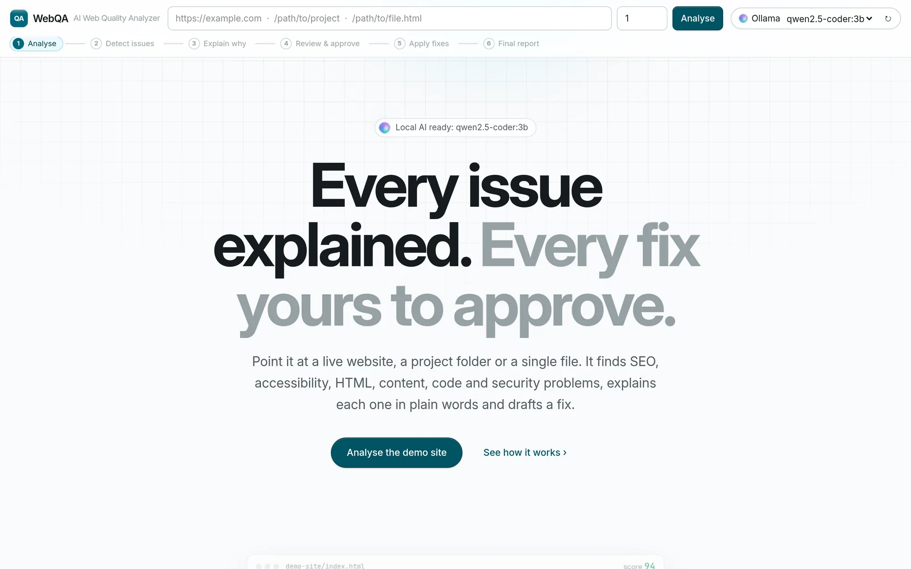
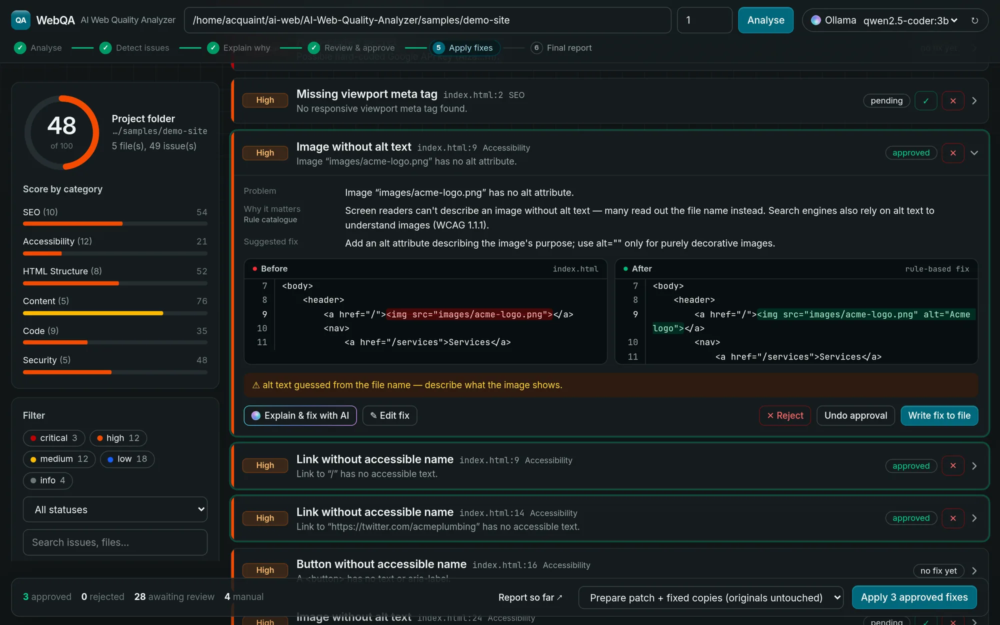
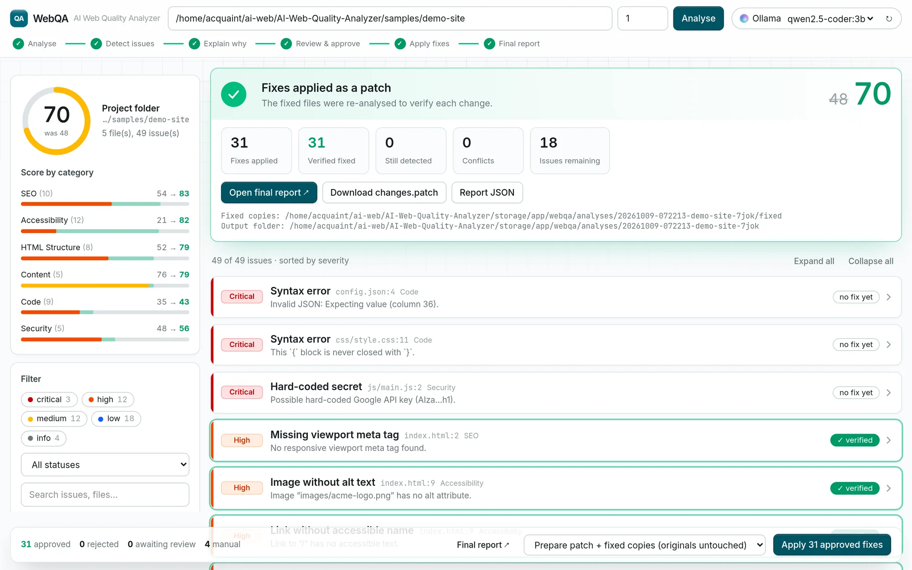
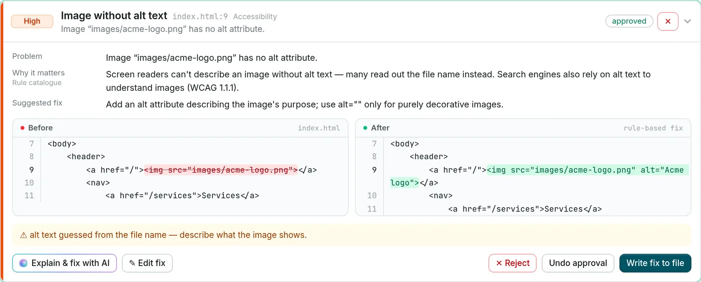
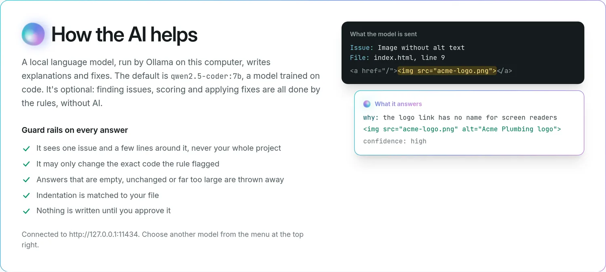
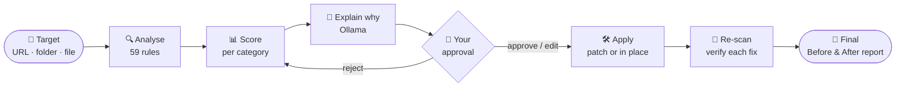

<div align="center">


# WebQA: AI Web Quality Analyzer

### Every issue explained. Every fix yours to approve.

Point it at a **live website**, a **project folder** or a **single file**. WebQA finds SEO, accessibility, HTML,
content, code and security problems, explains each one in plain words, drafts a fix with a **local AI model**, and
writes nothing until you approve it.

<p>
  
  
  
  
  
  
</p>
<p>
  
  
  
  
</p>

<p>
  <a href="#-quick-start"><b>Quick start</b></a> ·
  <a href="#-features"><b>Features</b></a> ·
  <a href="#%EF%B8%8F-how-it-works"><b>How it works</b></a> ·
  <a href="#-what-it-checks-59-rules"><b>Rules</b></a> ·
  <a href="#-connecting-ollama"><b>Ollama</b></a> ·
  <a href="#-documentation"><b>Docs</b></a> ·
  <a href="#-troubleshooting"><b>Troubleshooting</b></a>
</p>

<br>



</div>

<br>

## ✨ Features

<table>
  <tr>
    <td width="50%" valign="top">
      <h3>🔍 Analyse anything</h3>
      A URL, a whole site (sitemap first, up to 500 pages), a project folder or a single file.
      The site's own JavaScript and CSS are downloaded and checked too.
    </td>
    <td width="50%" valign="top">
      <h3>🧠 Local AI explanations</h3>
      Ollama explains <i>why</i> each issue matters and writes corrected code, on your own computer.
      No API keys and no cloud.
    </td>
  </tr>
  <tr>
    <td valign="top">
      <h3>✅ You approve every fix</h3>
      Approve, reject or edit each fix, and switch between the AI version and the rule version.
      Before and after code is shown side by side with line numbers.
    </td>
    <td valign="top">
      <h3>🔁 Each fix is re-checked</h3>
      After fixes are applied the files are scanned again. Each fix is marked <i>✓ verified</i> or
      <i>still detected</i>, and the score shows before → after.
    </td>
  </tr>
  <tr>
    <td valign="top">
      <h3>🛡️ Security report</h3>
      Leaked secrets, <code>eval()</code>, security headers (HSTS, CSP, clickjacking), cookie flags and server
      version disclosure. All read from normal responses; nothing is probed.
    </td>
    <td valign="top">
      <h3>🌍 Site profile</h3>
      Shows the platform (WordPress, Shopify, Laravel…), libraries, web server, CDN and hosting location,
      plus a screenshot of each page's first screen.
    </td>
  </tr>
  <tr>
    <td valign="top">
      <h3>📦 Patch or write in place</h3>
      Get <code>fixed/</code> copies and a <code>changes.patch</code> with your files untouched, or write to
      the project files with automatic backups.
    </td>
    <td valign="top">
      <h3>🧩 CLI, CI and Chrome</h3>
      <code>php artisan webqa:analyze</code> for pipelines (with <code>--fail-on</code>), plus a Chrome
      side-panel extension that runs the same checks on any page.
    </td>
  </tr>
</table>

<br>

## 📸 Screenshots

<table>
  <tr>
    <td align="center" width="50%">
      <br>
      <sub><b>Review:</b> problem, reason and before/after code for each issue</sub>
    </td>
    <td align="center" width="50%">
      <br>
      <sub><b>Verify:</b> fixes re-checked, score 48 → 70</sub>
    </td>
  </tr>
  <tr>
    <td align="center">
      <br>
      <sub><b>Issue card:</b> severity, location and a suggested fix</sub>
    </td>
    <td align="center">
      <br>
      <sub><b>AI with limits:</b> it sees one issue and changes only the flagged code</sub>
    </td>
  </tr>
</table>

<br>

## 🚀 Quick start

> [!NOTE]
> You need **PHP 8.3+** (with the `curl`, `dom` and `mbstring` extensions), **Composer** and **Node.js 20+**.
> Ollama is optional but recommended.

```bash
git clone https://github.com/Krunal-gif/AI-Web-Quality-Analyzer.git
cd AI-Web-Quality-Analyzer

composer install                 # PHP packages      → vendor/
npm install                      # JS packages       → node_modules/
cp .env.example .env             # local settings
php artisan key:generate         # writes APP_KEY into .env
npm run build                    # builds the React UI → public/build/

php artisan serve --no-reload    # → http://127.0.0.1:8000
```

Open **http://127.0.0.1:8000** and click **Analyse the demo site**. 🎉

> [!TIP]
> While working on the UI, run `npm run dev` in a second terminal instead of `npm run build`.
> If port 8000 is taken, add `--port=8080`.

<details>
<summary><b>📋 Detailed setup: check your tools, private-repo access, lerd</b></summary>

<br>

**1. Check your tools**

```bash
php -v                                       # PHP 8.3 or newer
php -m | grep -iE '^(curl|dom|mbstring)$'    # should list all three
composer --version
node -v                                      # v20 or newer
```

On Ubuntu, if PHP is missing: `sudo apt install php8.4-cli php8.4-curl php8.4-xml php8.4-mbstring`.

**2. Access to the repository (if it is private)**

1. Ask the repository owner to add your GitHub account under **Settings → Collaborators → Add people**.
2. Accept the invite. It arrives by email and at <https://github.com/notifications>.
3. Create a **classic** token: **Profile → Settings → Developer settings → Personal access tokens →
   Tokens (classic) → Generate new token (classic)**. Tick only the **`repo`** scope and copy the token
   (it starts with `ghp_` and is shown only once).
4. When `git clone` asks for credentials, use your **GitHub username** and paste the **token** as the password.

> A fine-grained token can't open a private repository owned by someone else's personal account. Use a classic one.

**3. Why `--no-reload`?**

`.env` sets `PHP_CLI_SERVER_WORKERS=4`, but Laravel only uses it with `--no-reload`. With a single worker the
server can't answer a request to itself, so analysing the app's own address would hang.

**4. Using lerd?**

If `which php` prints a path inside `~/.local/share/lerd/`, `php` runs inside a container and `php artisan serve`
won't be reachable from your browser. Use the system PHP instead:

```bash
/usr/bin/php8.4 artisan serve --no-reload
```

**5. Open it from another computer on your network**

Find this computer's address with `hostname -I` (for example `192.168.1.51`) and start the server on it:

```bash
php artisan serve --host=192.168.1.51 --port=8000 --no-reload
```

> [!WARNING]
> The app has **no login**. Anyone who can open that address can analyse folders on this computer and write
> fixes into them. Do this only on a network you trust, **never** use `--host=0.0.0.0`, and stop the server
> when you're done.

</details>

<br>

## ⚙️ How it works



1. **Analyse.** Enter a URL, folder or file. For a URL, choose **This page only** or **Whole site (sitemap)**.
   A site scan reads `robots.txt` and the sitemap (`/sitemap.xml`, `/sitemap_index.xml`, `/wp-sitemap.xml`,
   including sitemap index files), then follows links if the page limit allows.
2. **Detect.** Issues are sorted by severity, with a 0–100 score for each category and overall.
3. **Explain.** Each issue shows **Problem**, **Why it matters**, **Suggested fix** and the **Before / After** source.
   **✨ Explain & fix with AI** asks Ollama about one issue. **Explain & fix N with AI** runs a batch in the background.
4. **Review.** **✓ Approve**, **✕ Reject**, **✎ Edit fix**, or switch between **Use AI version** and **Use rule version**.
5. **Apply.** **Write fix to file** changes one spot straight away, or **Apply N approved fixes** applies them all:
   - **Prepare patch + fixed copies** (default): your files stay untouched.
   - **Write to project files**: edits in place, with the originals backed up first. Live websites always use patch mode.
6. **Verify & report.** The fixed files are scanned again. **Open final report** shows the Before & After report,
   and **Share report** sends it as a single `.html` file.

Reviews are saved automatically. Each analysis has its own URL (`/a/{id}`), and recent analyses are listed on the start page.

<br>

## 🧪 What it checks (59 rules)

| | Category | Rules | Examples | Auto-fix |
|:-:|---|:-:|---|:-:|
| 🔎 | **SEO** | 14 | title missing or wrong length, meta description, viewport, canonical, Open Graph, h1, noindex, robots.txt, sitemap, HTTP errors, slow response | most |
| ♿ | **Accessibility** | 8 | img `alt`, link and button names, form labels, `lang`, iframe title, generic link text, positive `tabindex` | most |
| 🏗️ | **HTML Structure** | 9 | doctype, charset, duplicate ids, deprecated tags, unclosed or stray tags, heading skips, inline styles, empty links | many |
| ✍️ | **Content** | 4 | lorem ipsum, repeated words, very long sentences, thin content | some |
| 💻 | **Code** | 9 | syntax errors (JSON, CSS, JS via `node --check`, PHP via `php -l`), `console.log`, `debugger`, `==`, `var`, TODO, empty CSS rules, too many `!important` | many |
| 🛡️ | **Security** | 15 | hard-coded secrets (AWS, Stripe, Google, GitHub, Slack…), `eval`, `target=_blank` without `noopener`, mixed content, no HTTPS, certificate chain, security headers, cookie flags | some |

**Supported files:** `.html` `.htm` `.css` `.js` `.mjs` `.cjs` `.json` `.php` `.py`. Folder scans skip `node_modules`,
`vendor`, `dist`, `build`, `storage`, `.git` and minified files.

<br>

## 🤖 Connecting Ollama

Without Ollama the tool still works: every issue gets a built-in explanation, and many get a rule-based fix.
With Ollama, each issue also gets an **AI explanation** and **AI-corrected code**.

```bash
curl -fsSL https://ollama.com/install.sh | sh   # Linux (macOS / Windows: download from ollama.com)
ollama pull qwen2.5-coder:3b                    # ~1.9 GB, a good fit for computers without a GPU
ollama serve                                    # only if it isn't already running
```

Click **↻** in the top-right pill. The orb turns colourful when the AI is ready, and the dropdown lets you pick any downloaded model.

### 🔒 How AI fixes are kept safe

| | Safeguard |
|:-:|---|
| 🎯 | The model sees **one issue** with a few lines of context, and may only rewrite the **exact flagged region**. |
| 🧾 | Its answer must be valid JSON. Empty, unchanged, oversized or structurally different output is discarded. |
| 📐 | Inserted lines are re-indented to match your file. |
| 🙋 | AI output is only ever a **proposal**. Nothing is written without your approval. |
| 🧩 | Approved fixes on the same tag are merged. Overlapping edits are reported as conflicts and never applied blindly. |
| 🧷 | In-place mode refuses to write a file that changed on disk after the analysis. |
| 🔁 | A **re-scan** confirms that each fix really resolved its issue. |
| 🏠 | Everything runs locally. Your code and content never leave your machine. |

Local models can take minutes, so AI requests return immediately. The work runs in a background process
(`php artisan webqa:ai-batch`) and the UI checks back for results.

<br>

## 🔧 Configuration

All settings live in `.env`:

| Variable | Default | What it does |
|---|---|---|
| `OLLAMA_HOST` | `http://127.0.0.1:11434` | Ollama address |
| `OLLAMA_MODEL` | `qwen2.5-coder:7b` | Default model (use `:3b` on computers without a GPU) |
| `OLLAMA_TIMEOUT` | `180` | Seconds per AI request (set `300` for 7b on a CPU) |
| `WEBQA_SCREENSHOTS` | `true` | Page previews with headless Chrome / Chromium |
| `WEBQA_CHROME` | auto | Path to Chrome if it isn't found automatically |
| `WEBQA_GEO_LOOKUP` | `true` | Hosting location from the server IP via ipwho.is (only the IP is sent) |
| `WEBQA_STORAGE` | `storage/app/webqa/analyses` | Where analyses, reports, patches and backups are stored |

<br>

## 💻 Command line & CI

```bash
php artisan webqa:analyze samples/demo-site
php artisan webqa:analyze https://example.com --pages=10 --ai --min-severity=medium
php artisan webqa:analyze ./theme --approve-rule-fixes --apply=patch --fail-on=high   # exit 1 if high+ remain
```

<br>

## 🧩 Extras

<table>
  <tr>
    <td width="50%" valign="top">
      <h3>🌐 Chrome extension</h3>
      <a href="chrome-extension/README.md"><code>chrome-extension/</code></a> runs the same checks on the page
      open in Chrome, from a side panel, with the same scoring, explanations, fixes and optional Ollama review.
      <br><br>
      <code>chrome://extensions</code> → <b>Load unpacked</b>. No build step.
    </td>
    <td width="50%" valign="top">
      <h3>🎬 Landing page</h3>
      <code>website/index.html</code> is a one-page product introduction with Apple-style scroll animations
      (GSAP + Lenis), built from real screenshots of the app.
      <br><br>
      <code>xdg-open website/index.html</code> (macOS: <code>open</code>). No build step.
    </td>
  </tr>
</table>

<br>

## 📚 Documentation

| | Guide | What's inside |
|:-:|---|---|
| 📘 | [**Developer Guide**](docs/1-Developer-Guide-How-To-Run-And-How-It-Works.pdf) | 31 slides: how to run it, how it works (including the AI model) and what every file does |
| 🛠️ | [**Build Log**](docs/2-Build-Log-Step-By-Step.pdf) | Every step used to build the project, each with its one-line command |
| 🎓 | [**Zero to Hero**](docs/3-Zero-To-Hero-Learning-Guide.pdf) | Learn from zero: concepts, setup, internals, building it yourself, exercises |
| 🎤 | [**Run Guide & Presentation Prep**](docs/4-Run-Guide-And-Presentation-Prep.pdf) | Running the demo and presenting the project |
| 🎯 | [**Exam Presentation: How the Code Works**](docs/5-Exam-Presentation-How-The-Code-Works.pdf) | 23 slides: architecture, parser, rules, scoring, AI, fixer, verification, demo script and examiner Q&A |

The PDFs are printed from editable HTML in [`docs/source/`](docs/source/README.md).

<br>

## 🗂️ Project layout

<details>
<summary><b>Show the folder tree</b></summary>

```
app/Analyzer/
├── Html/HtmlParser.php     position-aware HTML tokenizer (exact byte offsets for every tag and text run)
├── Html/HtmlEdit.php       setAttr / renameElement / humanize / truncate helpers for rule fixes
├── Rules/Catalog.php       59 rules: category, severity, why, how (the fallback when AI is off)
├── Rules/HtmlRules.php     SEO, accessibility, structure, content, HTML security
├── Rules/CodeRules.php     syntax checks, JS/CSS quality, secret detection
├── Rules/SiteRules.php     HTTP status, speed, robots.txt, sitemap, HTTPS
├── SourceLoader.php        URL (+ sitemap-first site crawl) / folder / file
├── SiteProfile.php         platform, libraries, server, CDN and hosting detection
├── Screenshots.php         page previews with headless Chrome
├── Ollama.php              prompts, JSON parsing, output validation
├── AiBatch.php             runs AI reviews in the background, one issue at a time
├── Fixer.php               apply approved fixes, merge/conflicts, patch, backups, verification
├── Diff.php                Myers diff (edit merging + unified patches)
└── Analysis.php            analysis state, saved in storage/app/webqa/analyses/{id}/
app/Http/Controllers/       AnalysisController (analyse, review, apply, reports), AiController
app/Console/Commands/       webqa:analyze, webqa:ai-batch, webqa:screenshots
resources/js/               React app: App.jsx + components (TopBar, Sidebar, IssueCard, CodePane, …)
resources/views/            app.blade.php (SPA shell), report.blade.php (Before & After report)
chrome-extension/           side-panel extension with the same rules
website/                    landing page (index.html + images/)
docs/                       PDF guides, printed from docs/source/*.html
samples/demo-site/          a small site full of deliberate issues
tests/                      PHPUnit: parser, rules, fixes, AI validation, workflow, HTTP API
```

Each analysis folder holds `report.html`, `report.json`, `changes.patch`, `fixed/` (patch mode) and `backup/` (in-place mode).

</details>

<br>

## ✅ Tests

```bash
php artisan test
```

<br>

## 🩺 Troubleshooting

<details>
<summary><b>Common problems and fixes</b></summary>

<br>

| Problem | Cause and fix |
|---|---|
| `git clone` fails with **403** or "Write access to repository not granted" | The token can't read this repo. Make a new **classic** token with **`repo`** ticked, and check that you accepted the collaborator invite. |
| `git clone` says **Authentication failed** | The token was mistyped or has expired. Copy it again or create a new one. |
| `composer.json` not found | The clone failed, so the folder doesn't exist. Fix the clone first. |
| `Failed to listen on …:8000 (Address already in use)` | A server is already running there. Use it, stop it with `Ctrl+C`, or add `--port=8080`. |
| The page can't be reached, but the terminal says "Server running" | On a lerd machine `php` runs in a container. Start the server with `/usr/bin/php8.4`. |
| `http://<name>.test` shows **404** | lerd's web server can't start because another tool (Lando, Docker) uses ports 80/443. Use `php artisan serve`. |
| Another computer can't open `http://<your-ip>:8000` | Check it is on the same network and that `ping <your-ip>` works. If not, the network blocks it (separate Wi-Fi, VLAN or client isolation). |
| The AI pill says **Ollama offline** | Ollama isn't running or no model is installed. See [Connecting Ollama](#-connecting-ollama). The app still works without it. |

</details>

<br>

## 🔐 Security note

> [!IMPORTANT]
> This is a **local developer tool**. It can read any folder under your home directory and, in in-place mode,
> write to it. Every POST is protected by Laravel's CSRF token, but the app has **no login**. Keep
> `php artisan serve` on `127.0.0.1` unless you need network access on a network you trust, and never use
> `--host=0.0.0.0`. **Only crawl sites you own or are authorised to test.**

<br>

## 📄 License

Released under the [MIT License](LICENSE). © 2026 Krunal Bhavsar

<div align="center">
<br>
<sub>Built with ❤️ using Laravel, React and local AI</sub>
<br>
<a href="#webqa-ai-web-quality-analyzer">⬆ Back to top</a>
</div>
